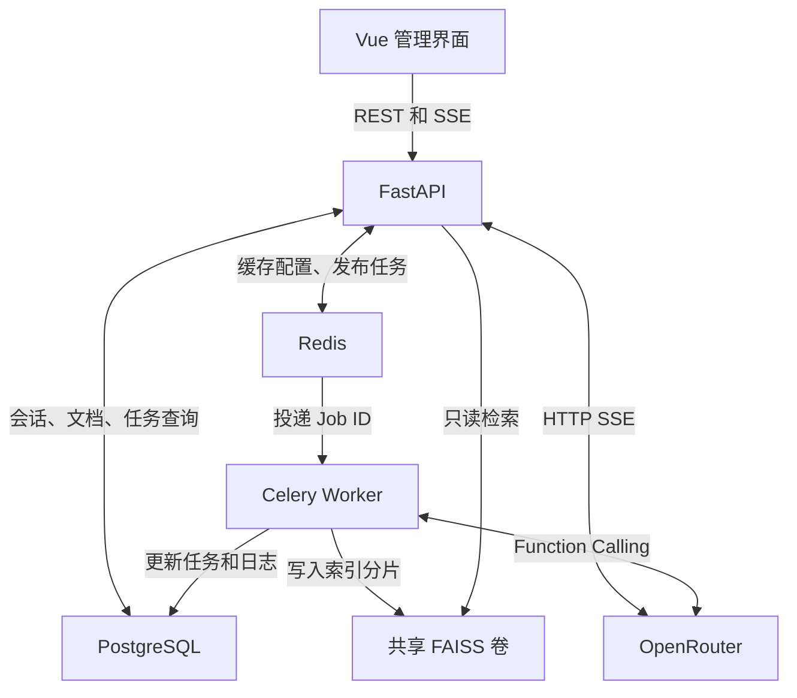

# Mini AI Platform

轻量级 AI 技术知识库与智能体管理平台。面向开发人员，用同一套技术文档演示登录、异步入库、检索、流式问答、Agent 报告和后台管理。

| 页面 | 功能 |
| --- | --- |
| 登录 | 预置 admin、alice、bob。后端验证 Argon2 哈希、签发 JWT、检查角色和归属 |
| AI 对话 | 模型切换、普通对话／RAG、POST SSE、停止接收、会话 CRUD、恢复历史 |
| 知识库 | 上传 UTF-8 Markdown/TXT、异步索引、删除文档、比较向量和 BM25 Top-K |
| 任务中心 | 提交文档分析任务、轮询状态、查看 Markdown 报告及工具轨迹 |
| 系统管理 | 查看用户、修改模型配置、按 Request ID 查询调用日志 |

技术栈为 Python 3.12、FastAPI、Pydantic、SQLAlchemy 2、PostgreSQL、PyJWT、HTTPX、JavaScript、Vue 3、Vue Router、Element Plus、Vite、Redis、Celery、Sentence Transformers、FAISS 和 BM25。用 uv、Docker Compose、Git 和 pytest 管理项目。依赖锁定在 `backend/uv.lock` 和 `frontend/package-lock.json`。

## 架构



Nginx 在前端容器内提供静态文件和同源 `/api/` 代理，关闭响应缓冲以传递 SSE。开发时使用 Vite proxy。API 与 Worker 是两个进程，共用后端代码和索引卷。详见 [架构与数据流](docs/ARCHITECTURE.md)。

## Windows PowerShell 启动

安装 Docker Desktop，请使用 Linux Containers 与 WSL 2。安装 uv，运行数据脚本。解压后进入包含 `docker-compose.yml` 的项目目录。

```powershell
Copy-Item .env.example .env
notepad .env
```

| 变量 | 填写 |
| --- | --- |
| `POSTGRES_PASSWORD` | 自己生成随机十六进制字符串，它将直接用于 Compose 的数据库连接 URL |
| `JWT_SECRET` | 至少 32 字符的独立随机字符串 |
| `DEMO_PASSWORD` | 10–128 字符的本地演示密码 |
| `OPENROUTER_API_KEY` | 自己的 OpenRouter Key。留空时仍可使用数据库、队列、索引与检索 |
| `FRONTEND_PORT`、`BACKEND_PORT` | 默认 8080、8000，端口占用时可修改 |

前三个值可以各运行一次 `[guid]::NewGuid().ToString('N') + [guid]::NewGuid().ToString('N')` 生成，填入本地 `.env`。默认配置为 `openai/gpt-4o-mini` 和 `google/gemini-2.5-flash-lite`。真实请求取决于账户额度、地区及路由可用性，两个模型都可能计费。可在管理界面修改模型 ID。

```powershell
docker compose version
docker compose config --quiet
docker compose up -d --build --wait
docker compose ps
Invoke-RestMethod http://127.0.0.1:8000/api/health
Start-Process http://127.0.0.1:8080
```

- Swagger 在 [http://127.0.0.1:8000/api/docs](http://127.0.0.1:8000/api/docs)。通过 `POST /api/auth/login` 登录，将 access token 填入 Authorize。
- 首次启动自动运行 `python -m app.seed`。管理员为 `admin`，普通用户为 `alice` 和 `bob`，三者使用首次设置的 `DEMO_PASSWORD`。也可运行 `docker compose exec api python -m app.seed`，脚本保留已有账号和配置。
- 日常可用 `docker compose stop`、`docker compose start`。也可以用 `docker compose down` 后再用 `docker compose up -d --wait`，命名卷会保留。
- 单独调试前端时先启动 API。进入 `frontend`，运行 `npm ci` 和 `npm run dev`。Vite 默认代理 `http://127.0.0.1:8000`，可在 PowerShell 设置 `$env:VITE_API_TARGET` 覆盖。

## 下载、导入和评测

```powershell
uv run --no-project python scripts/fetch_docs.py
uv run --project backend python scripts/platform_cli.py import
uv run --project backend python scripts/platform_cli.py evaluate
uv run --project backend python scripts/platform_cli.py evaluate --language zh
```

CLI 默认以 alice 登录并提示输入密码。可在子命令前传 `--user` 或 `--url http://127.0.0.1:8000`。首次演示可用 `fetch_docs.py --limit 1` 下载每类一篇，再用全量命令准备评测。导入按当前账号的来源 ID 跳过已有条目。`import --retry-failed` 会重传失败文档。下载和导入语料无需 OpenRouter Key。

语料为 FastAPI 20 篇、Vue 15 篇、Redis 15 篇、Celery 10 篇、Docker 10 篇、LangGraph 10 篇。下载到 `data/documents/`，由固定 Git commit、获取日期和 SHA-256 确认版本。项目包附来源清单和脚本，正文在运行下载脚本后生成。详见 [语料与许可](data/README.md)。

官方语料以英文为主，因此默认使用 `all-MiniLM-L6-v2`，只需 CPU，生成 384 维向量。实测权重缓存约 88 MB。首次索引或向量查询下载权重。模型输入超过 256 词元时会截断，当前以约 700 字符及 100 字符重叠做分块。推荐用英文问题展示检索。需要中文检索时，可对比多语种模型，API 和 Worker 必须使用同一模型并重新入库。

## 演示

1. 用 alice 登录。新建会话、重命名、刷新页面确认历史。切换到 bob，Alice 的历史不出现在列表。用 Bob 的 JWT 访问 Alice 的会话或文档 ID，应返回 404。
2. 在 Alice 的知识库上传一篇 TXT 或 Markdown，或通过 CLI 导入资料。任务中心会轮询状态。索引完成后任务显示 `SUCCESS`，文档显示 `READY`。在检索试验中分别用向量与 BM25 查 `Redis TTL`。
3. 选一个模型开始普通对话，再切另一个模型发下一条。用浏览器 Network 查 `text/event-stream`、`start → delta → done`。点停止取消请求，重新打开历史确认提交状态。
4. 切「知识库问答」，问 `What does Redis TTL return for a missing key?`，展开来源和证据。
5. 到「任务中心」提交 `Compare FastAPI BackgroundTasks and Celery. Cite evidence for each recommendation.`，看报告、轨迹和请求 ID。
6. 用 admin 登录，按这个请求 ID 查耗时、状态和 Token 数。修改 temperature，在 Swagger GET 同一个模型，确认得到新值。

## 测试

```powershell
docker compose exec api pytest -q
uv run --project backend pytest backend/tests -q
npm --prefix frontend ci
npm --prefix frontend test
npm --prefix frontend run build
# 配有真实 OpenRouter Key，且 Alice 已导入语料后执行
uv run --project backend python scripts/platform_cli.py smoke-openrouter
```

默认 pytest 用临时 SQLite。也可把 `TEST_DATABASE_URL` 指向空的专用 PostgreSQL 测试库。自动化测试的成功模型响应使用 Mock；索引单测用小矩阵代替模型下载，FAISS 仍走真实代码。真实 LLM 验证命令会发起两次普通对话、一次 RAG 和一次 Agent 任务。实测环境与结果见 [验收记录](docs/VERIFICATION.md)。

缓存演示可用 `docker compose exec redis redis-cli -n 0 TTL mini:model:1`。第一次读取模型后 TTL 应为 1–60 秒。再次读取继续倒计时。管理员更新后未再次读取时，TTL 返回 -2；下一次读取回源并写回。

## 常见问题

| 表现 | 检查方式 |
| --- | --- |
| API 启动失败 | `docker compose logs --tail=60 api db`。核对 `.env`、端口、数据库密码。旧数据卷使用首次初始化密码 |
| 索引长期待处理 | `docker compose logs --tail=80 worker redis`。检查 Worker、Broker 和 Hugging Face 连接。首次下载 CPU 权重可能较慢 |
| 下载官方文档失败 | 从能访问 GitHub Raw 的网络重试。输出会显示失败的文档 ID |
| OpenRouter 401、402、429 或超时 | 检查 Key、额度、模型或限速。更新 `.env` 后运行 `docker compose up -d api worker` |
| 流式内容一次性出现 | 浏览器 Network 检查是否分批收到 SSE；确认代理关闭响应缓冲 |
| Embedding 下载失败或切换模型 | 修复网络后可重传失败文档。模型更换后需要用同一设置重建已有文档索引 |

## 当前边界

单 API、单 Linux Worker。检索遍历当前用户的文档分片。数据库提交与 Broker 发布之间的极短故障窗口可能产生遗留任务。缓存短暂不一致由 TTL 兜底。SQLAlchemy `create_all` 用于本地首次建表。JWT 存在会话标签页内，预置账号用于本地演示。RAG 检索指标衡量证据覆盖，不衡量回答质量，证据不足题需要人工查看回答。部分上游源码用占位符引用示例文件，下载内容保留原始引用。

## 学习与参考

- [七阶段开发记录](DEVELOPMENT_LOG.md)、[学习指南](LEARNING_GUIDE.md)、[面试和简历参考](INTERVIEW_GUIDE.md)
- [FastAPI 教程](https://fastapi.tiangolo.com/tutorial/)、[async/await](https://fastapi.tiangolo.com/async/)、[官方全栈模板](https://github.com/fastapi/full-stack-fastapi-template)、[SQLAlchemy 2.0](https://docs.sqlalchemy.org/en/20/)
- [Vue 3 中文教程](https://cn.vuejs.org/tutorial/)、[Vue Router](https://router.vuejs.org/)、[Element Plus](https://element-plus.org/zh-CN/)
- [Docker Compose](https://docs.docker.com/compose/)、[Redis](https://redis.io/docs/latest/)、[Celery](https://docs.celeryq.dev/en/stable/)
- [OpenRouter Streaming](https://openrouter.ai/docs/api/reference/streaming)、[Tool Calling](https://openrouter.ai/docs/guides/features/tool-calling)、[Sentence Transformers](https://www.sbert.net/)、[FAISS](https://github.com/facebookresearch/faiss)、[MiniLM 模型卡](https://huggingface.co/sentence-transformers/all-MiniLM-L6-v2)
- 产品参考 [Dify](https://github.com/langgenius/dify) 和 [Open WebUI](https://github.com/open-webui/open-webui) 的知识库与管理界面，以及 [LiteLLM](https://github.com/BerriAI/litellm) 的统一调用参数设计。
