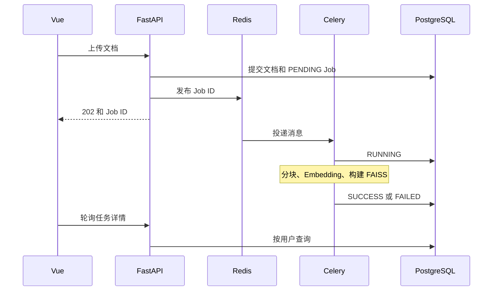

# 架构与关键调用链

| PostgreSQL 表 | 主关联 | 用途 |
| --- | --- | --- |
| users | username 唯一 | 密码哈希与角色 |
| model_configs | label 唯一 | 可修改的推理配置 |
| conversations | user_id | 标题、控制并行写入的 revision |
| messages | conversation_id | 用户与助手消息及证据快照 |
| documents | user_id | 原文、来源、版本、索引状态 |
| jobs | user_id | UUID、类型、输入、尝试次数、状态及结果 |
| call_logs | user_id、request_id | 模型、任务、开始时间、耗时、状态、错误、Token |

Vue 登录 → `main.login` 验证密码 → `common.issue_token` 签发 JWT。后续请求发送 Bearer Header。后端验证签名、有效期和受众，再从数据库查角色。`owned` 检查实际归属，列表按当前用户过滤。

SSE 入口 `chat.chat_stream`。请求先在短 Session 中加载会话修订号、最近 12 条消息和模型配置。异步生成器通过 HTTPX 读上游事件，写下游 `start`、`delta`、`done` 或 `error`。推理期间不持有事务。模型结束后成对保存消息，并检查会话修订号以防两次并发提交覆盖历史。`done` 在提交后发送。浏览器恰在提交后断开时，可重新打开会话核对。`sse.js` 用 TextDecoder 处理网络拆开的字节与事件。

- 原文在 PostgreSQL。API 与 Worker 共享 `/indexes`。Worker 把每篇文档的向量与片段放进 `/indexes/<user_id>/<document_id>.zip`，用临时文件写完后原子替换，再将数据库文档设为 `READY`。
- 单 Worker 串行写入。查询只读取当前用户的 `READY` 文档。单位化向量通过 FAISS `IndexFlatIP` 计算内积，即余弦相似度。每分片取候选后做全局 Top-K。BM25 用全部片段词项计算分数。
- Job 状态在 PostgreSQL 中。临时错误最多执行三次。发布失败会标记 FAILED。若 API 恰在数据库提交后、发布前退出，可能留下 PENDING。Worker 硬退出时的重投依赖 Broker 确认与可见性超时。部署恢复后可重新上传文档或提交任务，遗留记录需通过数据库排查。
- Agent 有两个只读工具。Pydantic 校验参数，读取工具再查归属。模型最多选择工具 4 轮，每轮最多 4 个调用，最后一次直接生成 Markdown。任务结果保留来源和调用轨迹。
- Redis DB 0 用于 60 秒 cache-aside，DB 1 用作 Broker。管理员提交数据库后删除缓存键。并发读可能回填旧值，TTL 将影响限制在短窗口内。
- REST 异常用 HTTP 状态码和 `error.message`、`error.request_id`。SSE 一旦开始，后续错误用 `event: error`。生成文本前，临时网络故障允许重试。管理后台通过 request ID 查询调用记录，日志保存受控错误及 API 实际返回的 token 数值。
